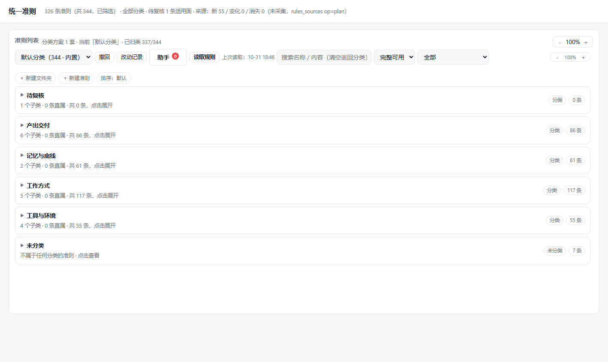
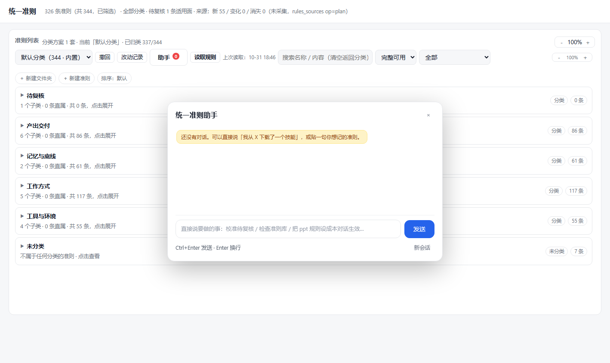
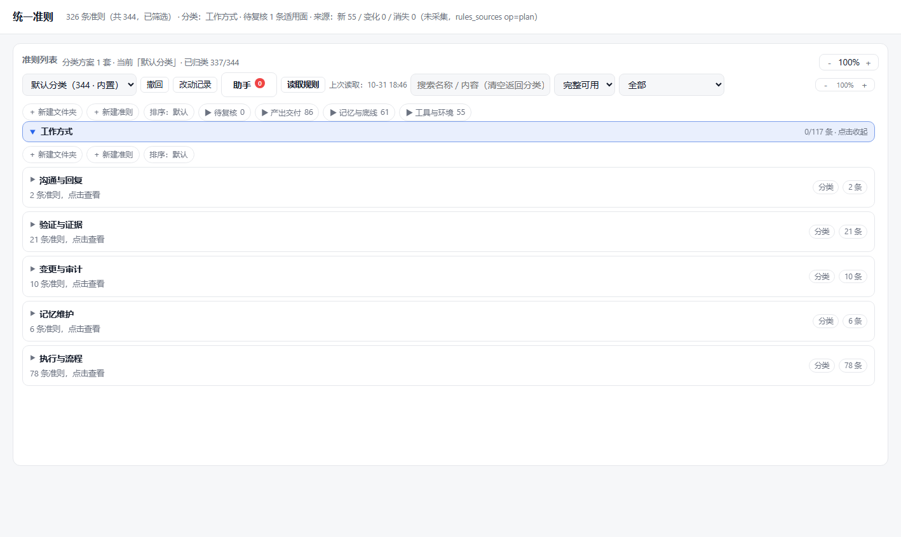

# dsh-rules — DSH 统一准则 / 规则层

把 agent 可用的所有准则收成**一份规则库**：统一管理、统一生效、可审计、可个性化。

- **规则库**：`~/.dsh/rules/rules.jsonl`（每行一条），带 `scope / category / key / value / priority / tags / source / status`
- **常驻出口**：生效规则自动同步到 `~/.dsh/AGENTS.md` 顶部**托管段**（`<!-- dsh-rules:begin ... end -->`），手写内容不受影响
- **适用面**：`default`（默认常驻）/ `local`（按任务域，按需路由）+ 会话级「本对话生效」
- **模型工具 23 个 · 宿主路由 23 条 · 管理页 + 右栏面板 + 面板内助手**

> 当前版本 **1.0.8**（首个公开版本）。变更见 [CHANGELOG.md](CHANGELOG.md)。

## 特性

- **统一规则库**：查询、解析、写入、批量改、审计、同步、导出、回滚、改动历史。
- **AGENTS 托管段**：只同步生效规则；摘要模式（中文名称 + 截断值）；改动前自动备份；可回滚。
- **默认 vs 局部**：默认规则进 AGENTS（体积可控）；局部规则按任务域路由，不占常驻预算。
- **读取规则**：一键扫描 `~/.dsh/AGENTS.md` 手写段、`EXPERIENCE.md`、项目 AGENTS.md、用户技能、插件自带技能、style-packs，增量收录并去重。
- **问题台账**：按**归属**分组（待复核 / 冲突 / 同标题多条 / 重复内容 / 来源失效 / 抑制清单 / 字段异常 / 适用面），通过助手汇报并给处理建议。
- **助手会话**：面板里的「助手」驱动一条真实 DSH 会话（以 `subagent` 子会话创建，不进左侧栏），做批量操作、导入技能、起草规则、个性化分类、校准与排错；职责写在 `~/.dsh/rules/ASSISTANT.md`，用户消息原样发送，不再拼大段约束；助手完成任务后面板自动刷新。
- **语义路由**：A 档零依赖；B 档可选本地 embedding，按任务描述命中领域与相关规则。
- **分类树**：基准 5 大类（产出交付 / 记忆与底线 / 工作方式 / 工具与环境 / 待复核），任意层级、多套方案、拖拽只移动不复制。
- **来源闸口与收割**：来源账、批量提取提案、合并去重、覆盖审计；`rules_collect` 做增量收录。
- **管理页 / 右栏**：单文件 HTML，无构建；搜索、筛选、缩放、逐级下钻、动画。

## 界面截图

| 总览 | 助手 | 分类 |
|---|---|---|
|  |  |  |

## 安装

**A. 插件市场（推荐）**
DSH 侧栏 **Plugins → 市场**，搜索 `dsh-rules` 安装，装完**重启 DSH**。

**B. 本地开发版（link）**
在 `~/.dsh/profiles/<profile>/package.json` 里加依赖，并把 `dsh-rules` 加入 `dsh.profile.bundles`：

```json
{ "dependencies": { "dsh-rules": "link:D:/Agent/ai_engine/plugins/dsh-rules" } }
```

插件目录还需要 `node_modules/@deepseek-ai/{dsh-tools,cordis,schemastery}` 指向宿主包的 junction，然后**重启 DSH**。详细步骤见 [docs/QUICKSTART.md](docs/QUICKSTART.md)。

## 快速开始

1. 重启 DSH，打开右栏 **统一准则** 页签（或 `http://127.0.0.1:<DSH端口>/dsh-rules/ui`）。
2. **首次打开是空库**（不预置任何准则——每个人规则不同）。点「读取规则」从系统现有来源收录，或对助手说「记一条…」。
   - 想载入一份通用示例：在 `~/.dsh/rules/config.json` 写 `{"seedDefaults": true}`，删掉 `rules.jsonl` 后重启。
3. 点 **读取规则**：把系统里现存的准则扫描收录进来（技能/插件/AGENTS/经验库/style-packs）。
4. 打开 **助手**：说「检查一下准则库」「帮我校准待复核」「按我的习惯重新分类」。
5. 想让规则立刻对所有会话生效：`rules_sync` / 面板「同步到全局」，必要时重启 DSH。

## 规则模型

| 字段 | 说明 |
|---|---|
| `scope` | `global` / `user` / `project:<路径>`（同 key 按 scopeRank + priority 取胜） |
| `category` | `paths / install / tools / style / safety / workflow / model / notify / skill / imported` |
| `key` | 如 `paths.downloads`、`tools.ppt`、`safety.delete_confirm` |
| `value` | 字符串（复杂对象用 JSON 字符串） |
| `priority` | 越大越优先；缺省 global=100 / user=200 / project=300 |
| `tags` | 可选；不填时按 key/title/value 自动推断 |
| `coverage` | `default`（常驻）/ `local`（局部，配合 `appliesTo` 任务域） |
| `status` | `active`（生效）/ `pending`（待校准）/ `deprecated` |
| `source` | 来源，如 `AGENTS.md`、`技能:<name>`、`style-packs:<domain>/<pack>` |

解析规则：同 key 只取 active 一条，按 priority 降序、scopeRank 排序取第一条；冲突在 `rules_audit` / 问题台账里报出。

## 模型工具（23）

| 工具 | 作用 |
|---|---|
| `rules_query` | 按类别/关键词/适用面/状态查规则 |
| `rules_resolve` | 按任务描述解析「此刻生效」的规则 |
| `rules_set` / `rules_remove` | 新增/修改、删除 |
| `rules_bulk` | 批量：改适用面/状态、本对话翻生效、批量移入分类节点 |
| `rules_route` | 语义路由（任务 → 领域 + 相关规则） |
| `rules_groups` | 分类方案/分类树管理（方案、节点、移动） |
| `rules_coverage` | 适用面统计、review/accept |
| `rules_collect` | 读取规则：扫描来源并收录（支持 dryRun / 重置抑制清单） |
| `rules_read` / `rules_mark_read` | 取未读/变更规则、标记已读 |
| `rules_issues` | 问题台账（按归属分组 + 建议） |
| `rules_audit` / `rules_report` | 体检、健康报告 |
| `rules_sync` / `rules_export` | 同步 AGENTS、导出 |
| `rules_sources` | 来源闸口（list/check/plan/record） |
| `rules_session` | 本对话生效（pin/unpin/set/clear） |
| `rules_draft` | 一句话 → 规则草稿 |
| `rules_history` / `rules_topology` | 改动记录、规则所属流程 |
| `rules_restore` / `rules_rollback` | 历史快照恢复、AGENTS 回滚 |

## 宿主路由（23）

`GET /dsh-rules/list`、`/audit`、`/coverage`、`/route`、`/tree`、`/report`、`/sources`、`/history`、`/session`、`/topology`、`/read-state`、`/backups`、`/project`、`/ui`
`POST /dsh-rules/set`、`/sync`、`/remove`、`/read`、`/assistant`、`/skill-import`、`/rule-draft`、`/rollback`、`/tree`

（完整定义见 `lib/index.js`。）

## CLI

```powershell
node scripts/cli.mjs list                      # 列出生效规则
node scripts/cli.mjs audit                     # 体检
node scripts/cli.mjs issues                    # 问题台账
node scripts/cli.mjs collect --dry-run         # 预览读取规则
node scripts/cli.mjs collect --list-sources    # 看来源分布
node scripts/cli.mjs collect --reset-suppressed# 清空删除抑制清单
node scripts/cli.mjs resolve "做一份 PPT"      # 语义路由
node scripts/cli.mjs sync                      # 同步 AGENTS 托管段
node scripts/cli.mjs groups show default       # 分类树
```

## 数据文件

```
~/.dsh/rules/rules.jsonl               规则本体（每行一条）
~/.dsh/rules/groups.json               分类方案 / 树（v2）
~/.dsh/rules/session-overrides.json    会话级生效（pins，7 天 TTL）
~/.dsh/rules/read-state.json           上次读取时间 + 每条指纹
~/.dsh/rules/ASSISTANT.md              面板助手的职责说明（助手工作区 AGENTS.md 同步此内容）
~/.dsh/rules/assistant-context.json    助手上下文（面板所在会话 tag，用于「本对话生效」）
~/.dsh/rules/collect-suppressed.json   删除抑制清单（读取时跳过）
~/.dsh/rules/history.jsonl             改动记录
~/.dsh/rules/coverage-map.json         适用面映射
~/.dsh/rules/embeddings.json           语义路由向量缓存（可选）
```

## 测试与维护脚本

```powershell
node scripts/selftest.mjs          # 110 项离线自检（临时 HOME，不碰真实规则）
node scripts/selftest-client.mjs   # client bundle 契约（右栏面板）
```

维护脚本（可选）：`harvest.mjs`（建来源清单）、`merge-proposals.mjs`（合并提案）、`coverage-map.mjs`、`maintain-coverage.mjs`、`reclassify-coverage.mjs`、`dedupe-rules.mjs`、`apply-dedupe-groups.mjs`、`import-rules.mjs`、`asar-skills.mjs`、`build-embeddings.mjs`、`setup-embed.mjs`。

## 已知限制

- 改写源文件后重新读取会新增新版、旧版保留（需手动删旧）。
- 修改规则「内容」不会被读取自动纠正（key 未变，按内容去重会跳过）。
- 标题按首句截断，可能出现同来源同标题的不同规则（问题台账可列）。
- `AGENTS.md` 超出宿主上下文预算（约 64KB）时，托管段仍在顶部，手写尾部会被截断。

## 许可

MIT，见 [LICENSE](LICENSE)。
